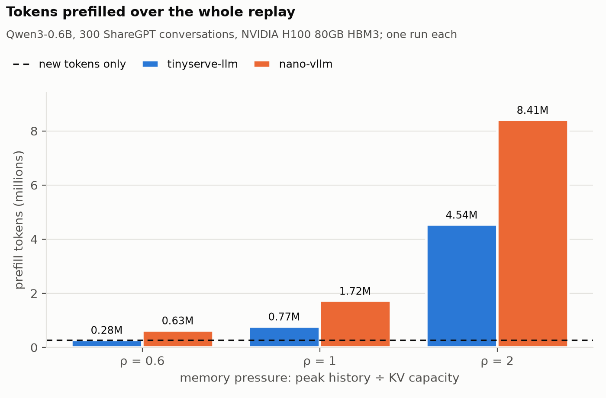
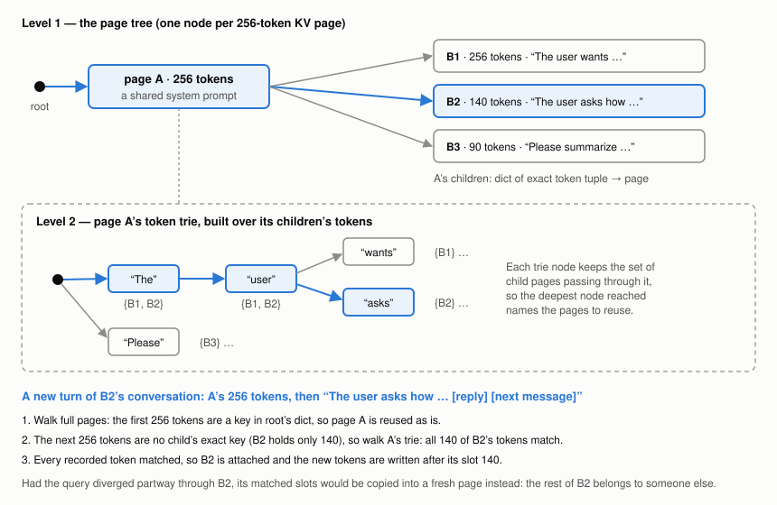

# tinyserve-llm

A small, readable inference engine in which memory management
is the first-class concern. Combines large KV pages, like vLLM's blocks, with token-level prefix matching, like SGLang's radix tree.

Supports Llama 3.2 and Qwen3 on flash-attn, in about 2,100
lines of Python plus one Triton kernel.

For comparison, on a multi-turn chat replay with the same KV memory, [nano-vllm](https://github.com/GeeeekExplorer/nano-vllm)
prefills **1.85–2.3×** as many tokens as tinyserve-llm, at the same throughput.



## Key features

* 🔍 **Token-granular prefix reuse with 256-token pages.** flash-attn needs pages of 256 tokens, but the
  prefix cache still reuses history down to the token instead of dropping the partly filled last page.
* 🌿 **Copy-on-write forking.** Parallel samples (`n > 1`) share every page, including a partly filled
  one, until they write to it.
* 🎯 **Cache-aware scheduling.** Waiting requests are ranked by how much of them is cached, with aging
  so cold requests aren't starved.
* 🧩 **One explicit boundary.** A clear interface separating concerns between engine and caching layer, 
  to allow support for multiple caching strategies in a "plug-and-play" style.

## How the prefix cache works

The cache is a tree of KV pages with a token trie on each page.



* **Page tree.** One node per 256-token page; a page's children are the pages that have followed it,
  keyed by their exact token tuple. A lookup walks the prompt one full page at a time.
* **Token trie.** When no child matches the next 256 tokens exactly, the parent's trie (built over its
  children's tokens) finds the child sharing the longest leading run.
* **Partial matches.** If the prompt matched every token a page holds, the page is attached and the
  sequence writes on after it. If the prompt diverged partway through, the matched slots are copied
  into a fresh page.
* **Eviction.** LRU over free leaf pages.

Prior art: SGLang's [RadixAttention](https://arxiv.org/abs/2312.07104) keeps a radix tree over tokens
with one-token pages; this is that idea adapted to large pages. vLLM and nano-vllm cache full blocks
under chained hashes.

## Results

Qwen3-0.6B, 300 multi-turn ShareGPT conversations replayed turn by turn, one H100 per run, the same
number of KV pages for both engines, and CUDA graphs off in both (tinyserve-llm
doesn't support CUDA graphs yet, but should soon). ρ is the KV needed to keep every live
conversation's history divided by the cache's capacity: at ρ 0.6 nothing has to be evicted, at ρ 2
the cache holds half of what's needed. "New tokens only" is the floor no cache can beat: 274,440 tokens.

| ρ | tinyserve-llm prefill | nano-vllm prefill | nano ÷ ours | output tok/s (ours / nano) |
|---|---|---|---|---|
| 0.6 | 276,681 (1.01× floor) | 629,213 | 2.3× | 1,112 / 1,126 |
| 1 | 773,457 | 1,720,029 | 2.2× | 1,124 / 1,121 |
| 2 | 4,536,766 | 8,409,016 | 1.85× | 951 / 930 |

Throughput is a tie: the workload is dominated by decoding, where per-step overhead matters most. Both
engines will be rerun with CUDA graphs on once tinyserve-llm supports them.

## Installation

Linux, CUDA, Ampere or newer. flash-attn's prebuilt wheels stop at torch 2.8, so pin it:

```bash
pip install "torch==2.8.*" --index-url https://download.pytorch.org/whl/cu128
pip install "https://github.com/Dao-AILab/flash-attention/releases/download/v2.8.3.post2/flash_attn-2.8.3.post2+cu12torch2.8cxx11abiTRUE-cp311-cp311-linux_x86_64.whl"
pip install -e .
```

The wheel name depends on your Python version and torch's C++ ABI; `scripts/gpu_setup.sh` picks it
automatically. For CPU only (the KV cache manager, scheduler and tests): `pip install -e ".[dev]"`.

## Quick start

```python
from tinyserve_llm import LLM, SamplingParams

llm = LLM("/path/to/Llama-3.2-1B-Instruct")  # or Qwen3; a local Hugging Face checkpoint
outputs = llm.generate(["Explain paged attention in one paragraph."],
                       SamplingParams(temperature=0.8, max_tokens=256))
print(outputs[0].texts[0])
```

Prompts are used as given; apply the chat template yourself for instruction-tuned models.

## Reproducing the benchmark

```bash
# 1. Build the trace (any machine), from ShareGPT_V3_unfiltered_cleaned_split.json
#    (Hugging Face dataset anon8231489123/ShareGPT_Vicuna_unfiltered) and Qwen3-0.6B's tokenizer
python -m benchmarks.build_trace --sharegpt ShareGPT_V3_unfiltered_cleaned_split.json \
    --tokenizer /path/to/Qwen3-0.6B --format qwen3 --out benchmarks/data/trace_qwen3.json

# 2. On a GPU machine: both engines' environments, then the grid (uses every GPU it finds)
bash scripts/lambda_setup.sh
bash scripts/lambda_bench.sh grid

# 3. Figures and summary table
python -m benchmarks.plot benchmarks/results/qwen
```

On 4 H100s the grid takes about 45 minutes. nano-vllm runs unmodified at a pinned commit; its counts
are read by wrapping three of its methods (`benchmarks/run_nano.py`).

## Tests

```bash
TINYSERVE_COMPILE=0 pytest tests -q   # CPU; GPU tests run automatically when CUDA is present
```

## Roadmap

* **Next:** HTTP serving, CPU offload of evicted pages, CUDA graphs.
* **Later:** chunked prefill, top-p sampling, beam search, other attention backends (FlashInfer).

## License

MIT. Model and sampling layers adapted from [nano-vllm](https://github.com/GeeeekExplorer/nano-vllm).
